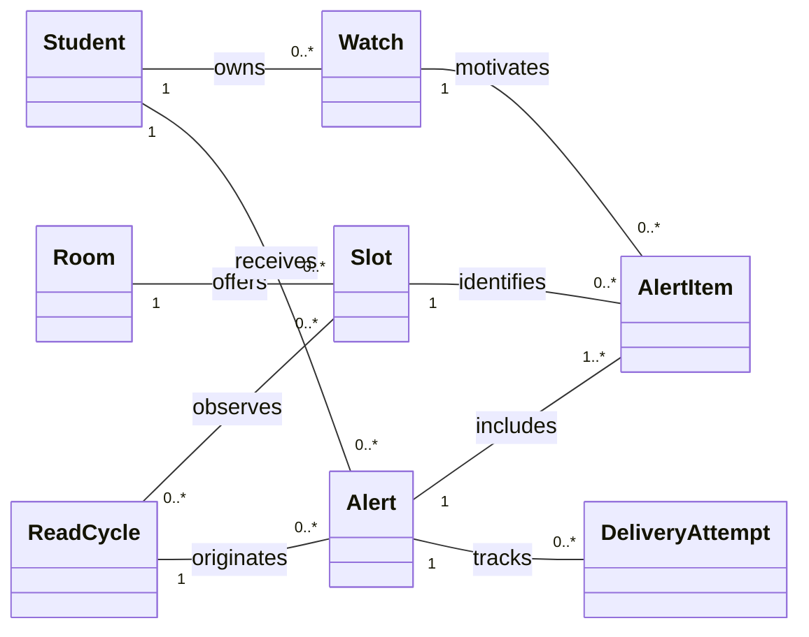
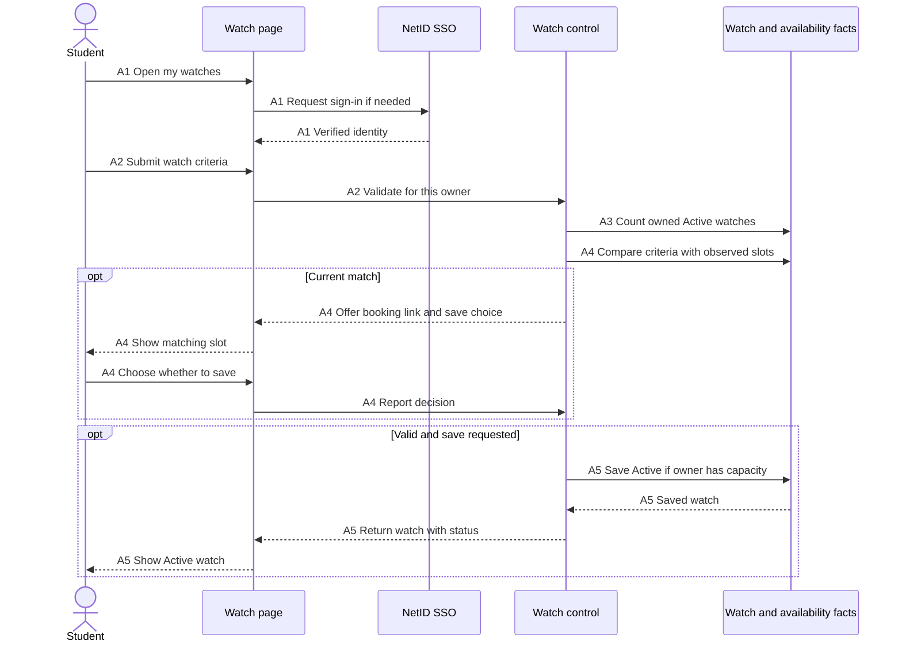
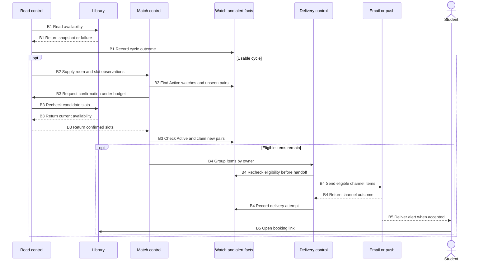

## 4. Use-case analysis

Students create watches, receive alerts and manage their own watches in UC-01 through UC-03. They book on McDermott Library's site. In UC-04, the operator can see when a library read failed and when the last one succeeded (FR-14).

### UC-01 · Create a room watch

**Primary actor** Enrolled student. **Supporting actor** UTD NetID SSO. **Entry condition** The service is available and the student has a NetID. **Trigger** No suitable room is available for the student's planned session.

| Turn | Action and observable response |
|---|---|
| 0 | The student opens Study Room Sniper to request an alert. |
| 1 | The system requests NetID sign-in when a verified session is absent. SSO returns the student's identity and the system opens the student's own watch list. |
| 2 | The student selects **New watch**. The system presents fields for a date, start and end times, minimum group size and optional browser push. Email is selected by default. |
| 3 | The student submits the criteria. The system checks the date against the seven-day horizon, the order of the times and a positive whole group size. |
| 4 | The system checks the owner's Active count and compares the criteria with the latest successful availability read. In the main flow, there is room for another watch and no current match. |
| 5 | The system saves one Active watch for this owner and acknowledges the submission by showing its criteria, channels and **Active** status in the list. The student can now leave the page. |

**Alternate turns.** At 1a, cancelled or failed sign-in returns the student to sign-in without creating a watch. At 3a, an invalid date, empty or reversed window, or invalid group size leaves the entered values in the form with a field-specific correction. At 3b, denied push permission keeps email selected and explains the fallback. At 4a, a sixth Active watch is refused, including when two submissions compete for the last place. The student can cancel a watch in UC-03 and try again. At 4b, a slot already shown free is presented with the library link. The student chooses whether to save the watch. Declining ends the flow with no new watch. If there is no usable read yet, acknowledge the saved watch and wait for the next successful cycle.

**Exit and trace.** A successful save belongs to the signed-in student and is eligible for the next read cycle. FR-01, FR-02, FR-04, FR-08, FR-10, FR-13.

### UC-02 · Get alerted when a matching room opens

**Primary actor** Student. **Supporting actors** Library Reservation System (LRS), email service and optional browser push service. **Entry condition** At least one Active watch has time remaining and the library is open. **Trigger** A fitting slot becomes free. Until Q4 is resolved, “bookable” means the library shows the slot as free. Only the library can establish whether this student may reserve it.

| Turn | Action and observable response |
|---|---|
| 0 | A slot opens in the LRS. A student with an Active watch is waiting for an alert. |
| 1 | On the next scheduled cycle the system reads all in-scope rooms. The LRS returns room availability. A successful cycle records when the read completed. |
| 2 | The system selects free slots on the watch's date, fully inside its time window, in rooms with listed capacity at least the group size. It excludes watch/slot pairs already alerted or pending. |
| 3 | The system requests a fresh, read-only confirmation under the shared budget. The LRS still shows the slot as free. The system checks the watch is still Active and in time and claims the eligible pair once. |
| 4 | The system groups this cycle's confirmed matches for the student. The email gives each room, start, end and library booking link. Optional push covers only matches from push-enabled watches. Each channel reports its own result. |
| 5 | The system records channel acceptance. The student receives the alert and follows the link. The library shows the current booking page and handles any reservation the student chooses to make. |

**Alternate turns.** At 1a, an unreadable or failed cycle is recorded for UC-04. The system discards its incomplete data and tries the next scheduled cycle. At 2a, a watch whose end has passed becomes Expired and is skipped. At 2b, simultaneous matches are listed together. A repeated slot is listed once even if it satisfies two of the same student's watches, with separate watch/slot records to prevent re-alerts. At 3a, a lost slot, unavailable confirmation or newly cancelled watch yields no send for that pair. A later read can reconsider an eligible, unsent pair. If dispatch is delayed or retried, confirm again before handoff. At 4a, explicit channel rejection allows up to three retries within five minutes. An accepted channel is skipped on retry. An unknown outcome is recorded for reconciliation. At 5a, a slot taken before the student opens the link is unavailable at the library. The watch remains Active for other openings.

**Exit and trace.** On success, the required email is accepted and its slots are recorded against the corresponding watches. A watch remains Active until cancellation or expiry. FR-03 through FR-08, FR-11, FR-12.

### UC-03 · Review and cancel my watches

**Primary actor** Student. **Supporting actor** UTD NetID SSO. **Entry condition** The student has a NetID. Cancellation requires an Active watch owned by the student. **Trigger** The student wants to check a watch or stop future alerts for it.

| Turn | Action and observable response |
|---|---|
| 0 | The student opens **My watches**. |
| 1 | The system resolves the student's NetID, requesting sign-in if needed. It returns only that owner's watches and shows each status in text. |
| 2 | The student chooses **Cancel** on an Active watch. The system identifies the date and time window of the selected watch and asks for confirmation. |
| 3 | The student confirms. The system checks ownership and current status again and records the Active-to-Cancelled transition. |
| 4 | The system acknowledges cancellation and displays the row as **Cancelled**. Later matches for this watch produce no new dispatch. |

**Alternate turns.** At 1a, failed sign-in reveals no watch data. An empty list provides a link to UC-01. At 2a, the student can finish after reading the list or abandon the confirmation. At 3a, a second cancellation returns the current Cancelled state. A watch whose window has already ended shows Expired. A request referring to another owner's watch receives no details and changes nothing. A provider may deliver an alert accepted before cancellation. Turn 4 promises only that subsequent dispatches stop.

**Exit and trace.** Viewing changes no active watch criteria. A cancelled watch no longer uses one of the student's five Active places. FR-02, FR-09, FR-10, FR-11.

### Self-review log

| Review of this draft | Finding and resulting change |
|---|---|
| UC-01 against P1 §3.4 | The initial success path alone missed the already-free case. Added 4b and made the student's save decision explicit. |
| UC-02 against FR-06, FR-08 and FR-12 | Separate optional push from required email. Record each channel's acceptance and retain the watch/slot association when batching. |
| UC-03 against FR-09 and FR-10 | Scope the list and cancellation to the signed-in owner. Added the stale-tab, repeat-cancel and already-accepted-alert cases. |

## 5. Analysis models

### Conceptual domain model

The **Student** is identified by NetID and has an email address. A **Watch** carries a local date, window, minimum group size, channel choice and status. A **Room** has a library identity and listed capacity. A **Slot** denotes one room and one start/end pair. Availability is the state of a slot observed during a **ReadCycle**. A failed cycle can have zero usable observations. **AlertItem** records a qualifying watch/slot pair, unique across cycles for that watch. An **Alert** groups items for one owner and one originating cycle. A **DeliveryAttempt** records channel and outcome, so one channel can fail after another succeeds. These are domain concepts. Storage choices belong in §6.

**Worked match.** A watch for four students on 6 November, 14:00–16:00, accepts a free four-seat room from 15:00–16:00 that day. A 15:30–16:30 slot extends past the end. A three-seat room fails even if its time fits. If the accepted slot appears in ten reads, the existing watch/slot item suppresses a second alert for that watch.

### UC-01 · From scenario to sequence

Each row describes a responsibility. Boundaries exchange information, controls coordinate the goal and entities carry domain facts. The sequence uses the same row keys as message labels.

| Key and turn | Actor or event | Boundary | Control responsibility | Entity or outcome |
|---|---|---|---|---|
| A1 · 1 | Student opens watches | Watch page / NetID SSO | Establish the verified owner | Student identity |
| A2 · 3 | Student submits criteria | Watch form | Validate date, window, group size and channels | Proposed watch |
| A3 · 4, 4a | Valid submission | Watch form | Check owner capacity and reject a sixth Active watch | Student and owned Watches |
| A4 · 4, 4b | Criteria ready | Watch form | Compare latest usable slots. If one fits, offer its link and a save choice | Room, Slot, ReadCycle |
| A5 · 5 | Submission may proceed | Watch list | Recheck limit when saving and acknowledge | New owned Watch, Active |

### UC-02 · From scenario to sequence

| Key and turn | Actor or event | Boundary | Control responsibility | Entity or outcome |
|---|---|---|---|---|
| B1 · 1, 1a | Poll due | LRS reader | Read in-scope rooms under budget and record outcome | ReadCycle, Room, Slot |
| B2 · 2, 2a–b | Successful cycle | Availability view | Compare each current watch, suppress repeats and group candidates by owner | Watch, Slot, AlertItem |
| B3 · 3, 3a | Candidate remains | LRS reader | Confirm current library state, recheck the watch and claim each eligible pair once | Watch, Slot, AlertItem |
| B4 · 4, 4a | Confirmed items | Email / push services | Hand off the matching slots per eligible channel and record outcome | Alert, DeliveryAttempt |
| B5 · 5, 5a | Student opens link | Library booking page | Library decides current eligibility and availability | No reservation in our domain |

### Six consistency checks

| Check | Cross-check and result |
|---|---|
| 1. Actors and boundary | A1 uses the external NetID actor in UC-01 and UC-03. B1/B3 only read the LRS. Only the student follows the link at B5, consistent with CON-01 and CON-02. |
| 2. Step coverage | UC-01's sign-in, validation, capacity, current-match choice and save appear at A1–A5. UC-02's read, match, confirmation, handoff and acknowledgment appear at B1–B5. |
| 3. Vocabulary and associations | A3 counts only Watches owned by one Student. B2 compares each Watch with a Slot in its Room. B4 follows AlertItem back to the motivating Watch and the exact Slot shown. |
| 4. Multiplicity and uniqueness | A5 enforces at most five Active watches, while historical Watch multiplicity remains unbounded. B3 claims a given watch/slot once. One Alert can cover several distinct items. |
| 5. State and time | Creation enters Active. UC-03 can change Active to Cancelled. An ended Active watch moves to Expired. B2/B3/B4 exclude ended or cancelled watches. A successful alert leaves the watch Active. |
| 6. Failure and visibility | B1 failure creates a ReadCycle outcome usable by UC-04 and stops evaluation of that cycle. B4 explicit rejection creates a DeliveryAttempt and permits bounded retry for that channel. Neither path shows a successful delivery solely because a match was found. |
