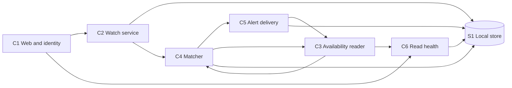
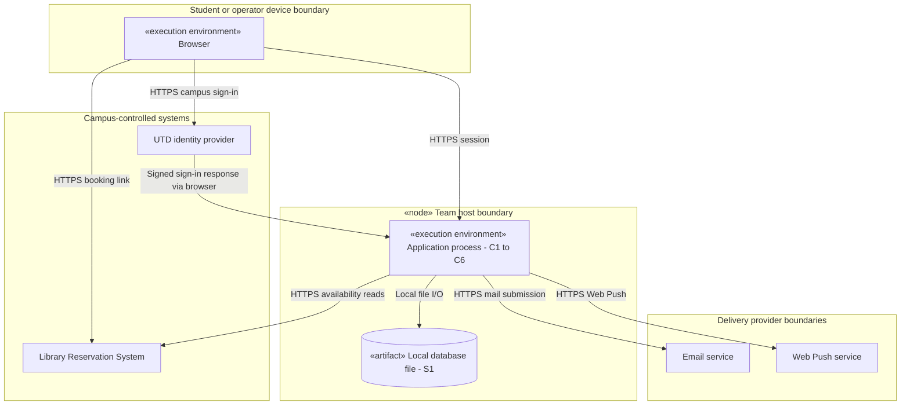

## 6 High-level design

### 6.1 Quality-attribute scenarios

These are acceptance targets from P1. Section 8 identifies which of them the spike exercises and under what assumptions.

| Scenario | Source, stimulus and operating conditions | Affected part and response | Response measure |
| --- | --- | --- | --- |
| QA-1 Timely alert (QR-01) | The stub releases a matching slot while 200 watches are Active. The library is open and the slot remains free. | C3 records availability, C4 identifies the watch and C5 sends the confirmed match. Measure from release until the student's email service accepts the message. | At least 95 of 100 scripted releases reach the email service within 180 s. Opening the message is outside this clock. |
| QA-2 Bounded traffic (FR-03, QR-05) | Many watches match at once during a 24-hour run with 200 Active watches. Confirmations compete with scheduled reads. | C3 arbitrates all library requests. It shares each room read across watches, coalesces confirmations of the same room where the source supports it, and defers work when the budget is exhausted. | At most 20 outgoing requests in any rolling 60 s. Separately, a 60-minute run against an always-reachable stub must show a maximum read gap of 120 s for every in-scope room. |
| QA-3 Service availability (QR-02) | An automated client probes the service every five minutes during library opening hours over 14 consecutive days. | The web process serves the check. C6 separately reports library-read health so an old snapshot remains visible to the operator as stale. | Successful checks divided by all scheduled opening-hour checks must be at least 99%. Count missing checks as failures. |
| QA-4 Accessible watch creation (QR-03, QR-04) | A first-time student opens the watch form on a phone. A keyboard or screen-reader user creates and cancels a watch. | C1 supplies labeled controls, announces validation and status changes in text, and returns focus to the affected control or result. | At least 9 of 10 first-time UTD students finish unaided in under 90 s. UC-01 and UC-03 screens must meet WCAG 2.2 AA, have zero serious or critical scan findings, and support every walkthrough step. |

### 6.2 Architecture and component view

A modular monolith serves the watch list and runs one background reader. The same release contains both, with one transactional store. A student who opens the watch list reads stored watch state. Their visit generates no extra request to the library. ADR-01 records why a service per component and polling from each student's browser were rejected.

**Figure 6.1.** Arrows show which component calls or supplies work to another. C3 supplies a shared snapshot to C4. C4 requests a fresh confirmation from C3 before claiming a pair, and C5 requests a new confirmation on a delayed send or retry. The C2 to C4 path checks the latest usable snapshot for the already-free alternative in UC-01. S1 is private to the application.

| Component | Analysis concepts and responsibility |
| --- | --- |
| C1 Web and identity | Presents Student and Watch data, verifies the campus sign-in response and passes the authenticated subject to C2. The operator view requires a separate role. |
| C2 Watch service | Owns Student and Watch. Filters reads and cancellations by authenticated owner. A single transaction enforces the five-Active-watch check and creation. Expiry continues even while the library is closed. |
| C3 Availability reader | Owns the read side of Room, Slot and ReadCycle. One scheduler and one rolling request budget cover polls, retries and confirmations. Rejects incomplete or malformed source data. |
| C4 Matcher | Compares Active Watch criteria with Slot times, status and Room capacity. Confirms candidates through C3, checks eligibility and claims each new AlertItem by watch and canonical slot. |
| C5 Alert delivery | Owns Alert and DeliveryAttempt. Checks eligibility at handoff, groups surviving items into one email per student per cycle, sends push for eligible items only, and records each channel's outcome. |
| C6 Read health | Consumes ReadCycle results. Reports the last complete successful read and a rolling one-hour count of failed reads to an authorized operator. A failed cycle leaves the prior success time intact. |
| S1 Local store | Persists ownership, watch state, alert items, delivery outcomes and read-health timestamps. A uniqueness constraint on watch and slot protects the alert history across worker restarts. |

### 6.3 Deployment and trust boundaries

**Figure 6.2.** The browser is an untrusted client. The application derives watch ownership from the verified campus subject. Only the browser follows the booking link. The read adapter targets an approved availability resource and exposes no reservation operations. The mail provider receives the destination and the match details needed for delivery. Push requires the student's opt-in and a privacy decision under QR-06. The sign-in exchange is conceptual until OIT confirms the supported protocol and claims under Q3.

**Design principles in use.** Ownership checks sit in C2 so the list and cancellation screens use the same rule. Isolating the LRS format in C3 lets a library format change fail a read without expiring a watch or sending a false alert. C4 compares domain data without calling a provider, so the same match can be repeated against a fixture. C5 keeps per-channel outcomes so a successful email does not get replayed when push fails.
